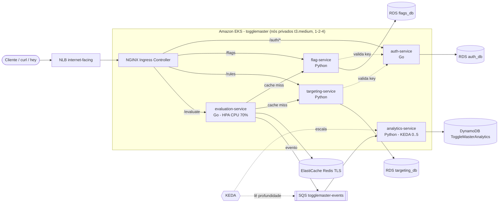

# ToggleMaster — Fase 2 (POSTECH DCLT)

Ecossistema de 5 microsserviços de feature flags conteinerizado e implantado no **Amazon EKS**, com escalabilidade por **HPA** (CPU) e **KEDA** (fila SQS).

## Arquitetura



| Serviço | Porta | Linguagem | Dados | Rota no Ingress |
|---|---|---|---|---|
| auth-service | 8001 | Go | RDS PostgreSQL `auth_db` | `/auth/*` |
| flag-service | 8002 | Python | RDS PostgreSQL `flags_db` | `/flags` |
| targeting-service | 8003 | Python | RDS PostgreSQL `targeting_db` | `/rules` |
| evaluation-service | 8004 | Go | ElastiCache Redis + SQS (produz) | `/evaluate` |
| analytics-service | 8005 | Python | SQS (consome) + DynamoDB | — (worker) |

## Estrutura

```
services/        código dos 5 microsserviços + Dockerfile multi-stage de cada um
docker-compose.yml + local/   ambiente local (9 containers)
infra/           eksctl-cluster.yaml, políticas IAM (IRSA), cloud.env.example
k8s/             manifestos (namespaces, deployments, services, configmaps, secrets, ingress, HPA, KEDA, jobs de schema)
scripts/         build/push ECR, geração de secrets, deploy, testes, carga, SQS, DevSecOps, destruição
docs/            PASSO_A_PASSO.md, ROTEIRO_VIDEO.md, RELATORIO_ENTREGA_FASE2.txt
```

## Início rápido

```bash
# local
cp .env.example .env    # preencha
eval "$(aws configure export-credentials --format env)"
docker compose up -d --build && docker compose ps

# nuvem: siga docs/PASSO_A_PASSO.md
```

Código-fonte original: https://github.com/FIAP-TCs (as correções aplicadas estão em `docs/PASSO_A_PASSO.md`, seção 0.4).
