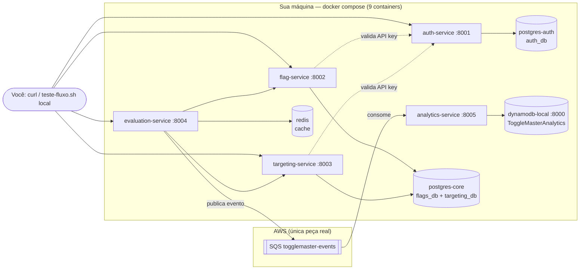
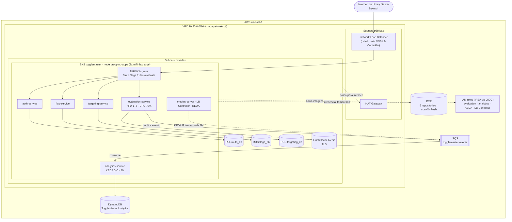

# Roteiro de apresentação final — ToggleMaster (Tech Challenge Fase 2)

Este é o roteiro **para gravar o vídeo**. Ele assume que tudo já foi testado (o histórico de erros e correções está no `ROTEIRO_GRAVACAO.md`, apêndice T1–T12).

Cada etapa tem sempre os mesmos 4 blocos, para não haver confusão na gravação:

| Bloco | O que é | Onde aparece no vídeo |
|---|---|---|
| 🖥️ **Comando** | o que cria o recurso | terminal |
| ✅ **Validar** | o comando que **prova** que foi criado | terminal |
| ☁️ **Console AWS** | onde o mesmo recurso aparece na AWS | navegador |
| 🎙️ **Fala** | o que você narra | voz |

> Todos os comandos rodam no **WSL**, na raiz do projeto: `cd /home/wmoya/ToggleMaster-Fase2 && source infra/cloud.env`
> 🔐 = cuidado para não mostrar o nº da conta ou segredos na tela.

---

## 1. Visão geral — diagramas

### 1.1 Ambiente local (Parte 1 — Docker, custo zero)



**Como ler:** os **5 serviços** são construídos do nosso código (`docker compose up --build`). Os **4 de apoio** (2 PostgreSQL, Redis e DynamoDB Local) são imagens prontas do Docker Hub. A única coisa real na AWS é a **fila SQS**, porque o SDK do evaluation não aceita fila local.


### 1.2 Ambiente AWS (Parte 2 — Kubernetes)



**Como ler:** o tráfego entra **só pelo Load Balancer** → NGINX Ingress → serviço certo pelo caminho. Bancos, Redis e nós ficam em **subnets privadas** (sem IP público). Cada microsserviço tem o **seu** RDS (*database per service*). Os pods acessam SQS/DynamoDB **sem chave**, com roles IRSA.


### 1.3 Local × AWS — o que muda

| Peça | Local (Parte 1) | AWS (Parte 2) |
|---|---|---|
| Orquestração | docker compose | EKS (Kubernetes) |
| Imagens | build local `togglemaster/*:local` | **as mesmas**, publicadas no ECR |
| Bancos | 2 containers PostgreSQL | **3 RDS** independentes |
| Cache | container Redis | ElastiCache Redis (TLS) |
| Eventos | DynamoDB Local | DynamoDB gerenciado |
| Fila | SQS real | SQS real (a mesma) |
| Entrada | portas 8001–8005 | 1 Load Balancer + Ingress |
| Credencial AWS | do seu shell | IRSA (sem chave) |
| Escala | não tem | HPA (CPU) + KEDA (fila) |

---

## 2. Antes de gravar — checklist

- [ ] Conta AWS no **plano pago** (o Free bloqueia o 3º RDS e o tipo de nó — T4/T9). Os créditos continuam valendo.
- [ ] Alerta de custo: **Billing → Budgets** (ex.: US$ 20).
- [ ] Docker Desktop **aberto** (integração WSL ligada).
- [ ] No WSL: `aws sts get-caller-identity` responde (credencial ok).
- [ ] `grep instanceType infra/eksctl-cluster.yaml` → `m7i-flex.large`.
- [ ] Terminal com fonte grande e `clear` antes de cada cena.

**Ordem e tempo do vídeo:**

| Parte | Conteúdo | Custo | Tempo de execução |
|---|---|---|---|
| 1 | Local (Docker) | zero | ~10 min |
| 2 | AWS: subir com o script + mostrar cada recurso | cobra por hora | ~50 min (script) |
| 3 | Escalabilidade (HPA e KEDA) + DynamoDB | cobra | ~15 min |
| 4 | Encerramento + destruir + validar remoção | — | ~30 min |

> 💡 **Como gravar a Parte 2 sem ficar 50 min esperando:** rode o `00-subir-ambiente.sh` **antes** de ligar a gravação (ou grave o início e corte a espera). No vídeo, para cada etapa, mostre o **comando** (o trecho do script, ou rode a etapa sozinha — ver 4.0), o **Validar** e o **Console**. O script é idempotente: rodar uma etapa que já existe só confirma e mostra o resultado.

---


## 3. PARTE 1 — Ambiente local (Docker)

### L0 — Começar do zero: derrubar e subir o ambiente local (antes de gravar)

Use antes da gravação para garantir um cenário limpo, sem containers, dados ou imagens de testes anteriores.

**1. Derrubar tudo** (containers, rede, volumes com os dados e imagens construídas):
```bash
cd /home/wmoya/ToggleMaster-Fase2
docker compose down -v --rmi local --remove-orphans
```
| Opção | O que remove |
|---|---|
| `down` | os 9 containers e a rede do compose |
| `-v` | os volumes: dados dos PostgreSQL e a tabela do DynamoDB Local |
| `--rmi local` | as imagens `togglemaster/*:local` (força um build novo) |
| `--remove-orphans` | containers antigos que não estão mais no compose |


**2. Conferir que ficou vazio:**
```bash
docker compose ps -a                          # esperado: nenhum container
docker volume ls | grep togglemaster          # esperado: nada
docker images | grep togglemaster             # esperado: nada
```

**3. Subir de novo** (é a sequência da L1 à L5, aqui em bloco para um teste rápido antes de gravar):
```bash
cd /home/wmoya/ToggleMaster-Fase2
aws sqs create-queue --queue-name togglemaster-events --attributes VisibilityTimeout=30,MessageRetentionPeriod=86400 >/dev/null
SQS_URL=$(aws sqs get-queue-url --queue-name togglemaster-events --query QueueUrl --output text)
[ -f .env ] || cp .env.example .env
sed -i "s|^AWS_SQS_URL=.*|AWS_SQS_URL=${SQS_URL}|" .env
eval "$(aws configure export-credentials --format env)"
docker compose up -d --build

docker compose ps                              # esperado: 9 containers

aws dynamodb create-table --endpoint-url http://localhost:8000 --table-name ToggleMasterAnalytics --attribute-definitions AttributeName=event_id,AttributeType=S --key-schema AttributeName=event_id,KeyType=HASH --billing-mode PAY_PER_REQUEST >/dev/null
source .env && export MASTER_KEY && scripts/teste-fluxo.sh local
aws dynamodb scan --endpoint-url http://localhost:8000 --table-name ToggleMasterAnalytics --select COUNT --no-cli-pager
```
> ⚠️ O `.env` **não é apagado** pelo `down`, então as senhas continuam as mesmas. Se for o primeiro uso (sem `.env`), gere as senhas com os comandos da **L2** antes do `docker compose up`.
> ⚠️ Se a fila tiver sido apagada pelo `99-destruir-ambiente.sh` há menos de 60 s, o `create-queue` falha (a AWS exige esse intervalo). Espere e repita.
> Se tudo responder, **derrube de novo** (passo 1) e grave a Parte 1 do zero, seguindo da L1 à L5 com as falas.


### L1 — Fila SQS
- 🖥️ **Comando:**
  ```bash
  aws sqs create-queue --queue-name togglemaster-events --attributes VisibilityTimeout=30,MessageRetentionPeriod=86400
  SQS_URL=$(aws sqs get-queue-url --queue-name togglemaster-events --query QueueUrl --output text)

  ```
- ✅ **Validar:** `aws sqs get-queue-attributes --queue-url "$SQS_URL" --attribute-names ApproximateNumberOfMessages`
- ☁️ **Console:** **Amazon SQS → Queues → togglemaster-events** (tipo *Standard*).

- 🎙️ **Fala:** "Começo pela fila SQS, a `togglemaster-events`. Ela liga o serviço de avaliação, que **produz** eventos, ao de analytics, que os **consome**. É a única peça da AWS que já uso no ambiente local."


### L2 — Arquivo `.env` (segredos fora do código)
- 🖥️ **Comando:**
  ```bash
  cp .env.example .env
  sed -i "s|^AWS_SQS_URL=.*|AWS_SQS_URL=${SQS_URL}|" .env
  sed -i "s|^PG_PASSWORD=.*|PG_PASSWORD=$(openssl rand -base64 18 | tr -d '/+=')|" .env
  sed -i "s|^MASTER_KEY=.*|MASTER_KEY=$(openssl rand -hex 16)|" .env
  sed -i "s|^SERVICE_API_KEY=.*|SERVICE_API_KEY=tm_key_$(openssl rand -hex 32)|" .env
  ```
- ✅ **Validar:** `grep -E '^(AWS_REGION|AWS_DYNAMODB_TABLE|PG_USER)=' .env` (só o que **não** é segredo 🔐)
- ☁️ **Console:** não se aplica.
- 🎙️ **Fala:** "As senhas ficam no `.env`, que está no `.gitignore` e nunca vai pro repositório. Gero tudo com `openssl`: nada fica fixo no código."


### L3 — Subir os 9 containers 🎥
- 🖥️ **Comando:**
  ```bash
  eval "$(aws configure export-credentials --format env)"   # PRIMEIRO: credencial no shell
  docker compose up -d --build
  ```
- ✅ **Validar:** `docker compose ps` → **9 containers** `running`/`healthy`.
- ☁️ **Console:** **Docker Desktop → Containers → togglemaster** (os 9 containers).
- 🎙️ **Fala:** "Com um `docker compose up` subo a stack inteira: os **5 microsserviços**, construídos do nosso código por Dockerfiles multi-stage, e os **4 de apoio** — dois PostgreSQL, o Redis e o DynamoDB Local — baixados prontos do Docker Hub. A rede do compose liga tudo pelo nome do serviço."


### L4 — Tabela no DynamoDB **Local**
- 🖥️ **Comando:**
  ```bash
  aws dynamodb create-table --endpoint-url http://localhost:8000 --table-name ToggleMasterAnalytics --attribute-definitions AttributeName=event_id,AttributeType=S --key-schema AttributeName=event_id,KeyType=HASH --billing-mode PAY_PER_REQUEST
  ```
- ✅ **Validar:** `aws dynamodb list-tables --endpoint-url http://localhost:8000`
- ☁️ **Console:** **não aparece** na AWS — é local (prova: `aws dynamodb list-tables` **sem** `--endpoint-url` não mostra a tabela).

- 🎙️ **Fala:** "O `--endpoint-url localhost:8000` aponta o CLI para o DynamoDB Local, aqui na minha máquina. É a mesma tabela que vou criar na nuvem — lá, sem esse parâmetro."


### L5 — Teste de ponta a ponta local 🎥
- 🖥️ **Comando:**
  ```bash
  source .env && export MASTER_KEY
  scripts/teste-fluxo.sh local
  ```
  *(cria API key → flag → regra de 50% → lista → avalia 10 usuários).*
- ✅ **Validar:**
  ```bash
  docker compose logs --tail=20 analytics-service      # "Evento ... salvo no DynamoDB"
  aws dynamodb scan --endpoint-url http://localhost:8000 --table-name ToggleMasterAnalytics --select COUNT --no-cli-pager
  ```
- ☁️ **Console:** **SQS → togglemaster-events → Monitoring** (mensagens enviadas/recebidas).
- 🎙️ **Fala:** "O script percorre o produto inteiro: cria uma chave, uma flag, uma regra de 50% e avalia 10 usuários. Cada avaliação vira evento na fila, o analytics consome e grava no DynamoDB Local. O `Count` maior que zero prova o fluxo assíncrono de ponta a ponta."

> Ao terminar a Parte 1: `docker compose down` (opcional — libera memória).


########### AWS ######################


## 4. PARTE 2 — Ambiente AWS (começa a cobrar)

### 4.0 Subir tudo com um script
- 🖥️ **Comando (tudo de uma vez, ~40–60 min):**
  ```bash
  cd /home/wmoya/ToggleMaster-Fase2 && source infra/cloud.env
  scripts/00-subir-ambiente.sh
  ```
  **Ou uma etapa por vez** (para gravar cada uma ao vivo):
  ```bash
  scripts/00-subir-ambiente.sh prereq cluster      # depois: ecr, rede, rds, redis, dynamodb, endpoints, irsa, ingress, keda, deploy, teste
  ```
- ✅ **Validar tudo (cena que fecha a Parte 2):**
  ```bash
  scripts/07-validar-ambiente.sh        # ✅/❌ por requisito; no fim "Ambiente 100% pronto"
  ```
- 🎙️ **Fala:** "Para a nuvem, automatizei a criação em um script que executa, na ordem, cada etapa que vou mostrar agora. Ele é idempotente — se algo já existe, só confirma. No fim, um script de validação confere item por item tudo o que o desafio pede."

> Cada etapa abaixo tem o nome que o script imprime (`==== A1 ... ====`). Se uma falhar, rode de novo só ela.

### A1 — Cluster EKS 🎥 (etapa `prereq` + `cluster`)
- 🖥️ **Comando (o que a etapa executa):**
  ```bash
  eksctl create cluster -f infra/eksctl-cluster.yaml
  ```
- ✅ **Validar:** `kubectl get nodes -o wide` → 2 nós `Ready`.
- ☁️ **Console:**
  - **Amazon EKS → Clusters → togglemaster → Overview** (Status *Active*, versão 1.34).
  - Aba **Compute** → node group **ng-apps** (m7i-flex.large · min 1 / desejado 2 / máx 4).
  - Aba **Add-ons** → vpc-cni, coredns, kube-proxy, metrics-server.
  - **CloudFormation → Stacks** → `eksctl-togglemaster-cluster` e `eksctl-togglemaster-nodegroup-ng-apps`.
  - **VPC → Your VPCs** → `eksctl-togglemaster-cluster/VPC` (subnets públicas/privadas + NAT Gateway).
- 🎙️ **Fala:** "O enunciado deixa a ferramenta à escolha; uso o **eksctl**, que com um arquivo declarativo cria tudo de forma reproduzível — por baixo ele usa o CloudFormation, aqui as stacks. Ele cria a VPC com subnets públicas e privadas, o control plane e o node group com auto scaling de 1 a 4 nós, e já liga o **OIDC**, que destrava o IRSA. Os nós ficam em subnets privadas, por segurança."

### A2 — ECR: 5 repositórios + imagens 🎥 (etapa `ecr`)
- 🖥️ **Comando:** `scripts/01-ecr-build-push.sh` (cria os repos com `scanOnPush`, builda `linux/amd64` e dá push).
- ✅ **Validar:** `aws ecr describe-repositories --query 'repositories[].repositoryName' --output table`
- ☁️ **Console:** **Amazon ECR → Private repositories** → os 5 `*-service` → abrir um → imagem `v1` → **Vulnerabilities** (scan).
- 🎙️ **Fala:** "As **mesmas imagens** que rodaram no compose vão para cinco repositórios privados no ECR. Com o scan no push ligado, toda imagem publicada é escaneada pela AWS automaticamente."

### A3 — Rede dos bancos (etapa `rede`)
- 🖥️ **Comando:** cria `togglemaster-rds-sg` (porta 5432) e `togglemaster-redis-sg` (6379) liberados **só** para o security group do cluster, e os subnet groups nas subnets privadas.
- ✅ **Validar:** `aws ec2 describe-security-groups --filters Name=group-name,Values=togglemaster-* --query 'SecurityGroups[].GroupName' --output text`
- ☁️ **Console:** **EC2 → Security Groups** → `togglemaster-rds-sg` → aba **Inbound rules** (origem = SG do cluster, não a internet).
- 🎙️ **Fala:** "Antes dos bancos, crio as regras de rede: o PostgreSQL e o Redis só aceitam conexão vinda do cluster. Nada exposto para a internet."

### A4 — 3 RDS PostgreSQL 🎥 (etapa `rds`)
- 🖥️ **Comando:** `aws rds create-db-instance ...` × 3 (`db.t3.micro`, sem acesso público, disco criptografado).
- ✅ **Validar:** `aws rds describe-db-instances --query 'DBInstances[].[DBInstanceIdentifier,DBInstanceStatus,PubliclyAccessible]' --output table` → 3 × `available` · `False`.
- ☁️ **Console:** **Amazon RDS → Databases** → `togglemaster-auth-db`, `-flag-db`, `-targeting-db` → aba **Connectivity & security** (*Publicly accessible: No*, SG `togglemaster-rds-sg`).
- 🎙️ **Fala:** "Crio **três RDS PostgreSQL independentes**, um para cada serviço que tem dado relacional. É o padrão *database per service*: cada microsserviço é dono do seu dado. Sem acesso público e com disco criptografado."

### A5 — ElastiCache Redis 🎥 (etapa `redis`)
- 🖥️ **Comando:** `aws elasticache create-replication-group ...` (`cache.t3.micro`, TLS em trânsito e em repouso).
- ✅ **Validar:** `aws elasticache describe-replication-groups --replication-group-id togglemaster-redis --query 'ReplicationGroups[0].Status'` → `"available"`.
- ☁️ **Console:** **ElastiCache → Redis OSS caches → togglemaster-redis** (*Encryption in transit: Enabled*).
- 🎙️ **Fala:** "O Redis gerenciado é o cache do serviço de avaliação: a resposta 'flag ligada ou não' sai da memória, sem ir ao banco toda hora. A conexão é por TLS — por isso `rediss://`."

### A6 — DynamoDB 🎥 (etapa `dynamodb`)
- 🖥️ **Comando:** `aws dynamodb create-table --table-name ToggleMasterAnalytics ... --billing-mode PAY_PER_REQUEST` (o mesmo da L4, **sem** `--endpoint-url`).
- ✅ **Validar:** `aws dynamodb describe-table --table-name ToggleMasterAnalytics --query 'Table.TableStatus'` → `"ACTIVE"`.
- ☁️ **Console:** **DynamoDB → Tables → ToggleMasterAnalytics** (*Capacity mode: On-demand*, chave `event_id`).
- 🎙️ **Fala:** "A mesma tabela do ambiente local, agora gerenciada e em modo *on-demand*: pago só pelo que uso."

> 💡 **Fala-resumo dos dados (fala 10 do checklist):** "**RDS** guarda os dados principais — chaves, flags e regras; **Redis** responde rápido da memória; **DynamoDB** guarda o histórico de cada avaliação."

### A7 — Endpoints no `cloud.env` (etapa `endpoints`)
- 🖥️ **Comando:** espera RDS e Redis ficarem prontos e grava os endereços no `infra/cloud.env`.
- ✅ **Validar:** `grep -E '^export (RDS_|REDIS_URL)' infra/cloud.env | sed 's/=.*/=<preenchido>/'` 🔐
- ☁️ **Console:** **RDS → togglemaster-auth-db → Endpoint** (é esse endereço que foi gravado).
- 🎙️ **Fala:** "Anoto o endereço de cada recurso no `cloud.env`. Esses valores viram Secrets do Kubernetes — nunca ficam no código."

### A8 — IRSA: permissões sem chave (etapa `irsa`)
- 🖥️ **Comando:** cria as políticas IAM mínimas e `eksctl create iamserviceaccount` para o evaluation (enviar na SQS) e o analytics (ler a SQS + gravar no DynamoDB).
- ✅ **Validar:** `kubectl get sa -n togglemaster-analytics analytics-service-sa -o yaml | grep -c role-arn` → `1` (não mostra o ARN 🔐).
- ☁️ **Console:** **IAM → Roles → togglemaster-analytics-irsa** → **Permissions** (política `TogglemasterAnalyticsSQSDynamo`) e **Trust relationships** (o OIDC do cluster).
- 🎙️ **Fala:** "Cada pod que fala com a AWS recebe um 'crachá': uma role IAM com o mínimo de permissão, ligada à sua service account via OIDC. A credencial é temporária e injetada pela AWS — **nenhuma access key dentro do cluster**. É a melhor prática."

### A9 — Load Balancer Controller + NGINX Ingress 🎥 (etapa `ingress`)
- 🖥️ **Comando:** `helm install aws-load-balancer-controller` (com IRSA) e `helm install ingress-nginx` exposto por NLB.
- ✅ **Validar:** `kubectl -n ingress-nginx get svc ingress-nginx-controller` → `EXTERNAL-IP` = `...elb.amazonaws.com`.
- ☁️ **Console:** **EC2 → Load Balancers** → NLB `k8s-ingressn-...` (*Type: network*, *Scheme: internet-facing*) → aba **Resource map** (targets = pods do NGINX).
- 🎙️ **Fala:** "O NGINX Ingress é a portaria do cluster: um único ponto de entrada que encaminha cada caminho ao serviço certo. Quem cria o Network Load Balancer na AWS é o AWS Load Balancer Controller, também com IRSA, como o enunciado recomenda."

### A10 — KEDA (etapa `keda`)
- 🖥️ **Comando:** role IRSA do KEDA (só **ler** a fila) + `helm install keda`.
- ✅ **Validar:** `kubectl -n keda get pods` → operator, metrics-apiserver e webhooks `Running`.
- ☁️ **Console:** **EKS → togglemaster → Resources → Workloads** (namespace `keda`).
- 🎙️ **Fala:** "O KEDA vai escalar o analytics pelo tamanho da fila SQS — inclusive até **zero** pods quando não há evento."

### A11 — Deploy dos 5 microsserviços 🎥 (etapa `deploy`)
- 🖥️ **Comando:** `scripts/05-gerar-secrets.sh` (os 5 Secrets) + `scripts/06-deploy-k8s.sh` (namespaces → secrets → configmaps → jobs que criam as tabelas → deployments/services/ingress → HPA/KEDA).
- ✅ **Validar:**
  ```bash
  kubectl get pods -A -l app.kubernetes.io/part-of=togglemaster      # auth, flag, targeting, evaluation Running
  kubectl get ingress -A                                              # /auth /flags /rules /evaluate
  ```
  *(o analytics aparece com **0 pods** — é o KEDA economizando, esperado.)*
- ☁️ **Console:** **EKS → togglemaster → Resources → Workloads → Deployments** (os 5, um namespace por serviço) · **Resources → Service and networking → Ingresses**.
- 🎙️ **Fala:** "Cada serviço tem seu **namespace**, **Deployment** apontando para a imagem do ECR, **Service** interno, **ConfigMap** e **Secret**. Todos com limites de CPU e memória e probes de saúde. Os pods em `Running` mostram que conectaram nos bancos e no Redis. Detalhe: **base64 do Secret não é criptografia** — o acesso é controlado por RBAC; em produção entraria um cofre como o Secrets Manager."

### A12 — Teste pelo Load Balancer 🎥 (etapa `teste`)
- 🖥️ **Comando:**
  ```bash
  LB=$(kubectl -n ingress-nginx get svc ingress-nginx-controller -o jsonpath='{.status.loadBalancer.ingress[0].hostname}')
  curl -s http://$LB/auth/health; echo
  export MASTER_KEY && scripts/teste-fluxo.sh $LB
  ```
- ✅ **Validar:** `/auth/health` responde e o script completa os 7 passos.
- ☁️ **Console:** **EC2 → Load Balancers → (NLB) → Monitoring** (requisições chegando).
- 🎙️ **Fala:** "Agora pela porta da frente: o mesmo teste da parte local, passando pelo Load Balancer e pelo Ingress. A chave, a flag e a regra são criadas nos RDS, e cada avaliação gera um evento na fila."

### A13 — Validação completa 🎥
- 🖥️ **Comando:** `scripts/07-validar-ambiente.sh`
- ✅ **Validar:** todos os itens ✅ e `Ambiente 100% pronto para a gravação.`
- 🎙️ **Fala:** "Para fechar a infraestrutura, este script confere cada requisito do desafio: cluster, 5 ECR, 3 RDS, Redis, DynamoDB, SQS, IRSA, Ingress, KEDA, os 5 serviços, HPA e o tráfego pelo Load Balancer."

---

## 5. PARTE 3 — Escalabilidade (a prova principal)

### E1 — HPA: evaluation escala por CPU 🎥
- 🖥️ **Comando (3 terminais):**
  ```bash
  # T1 — mostrar o HPA
  kubectl get hpa -n togglemaster-evaluation -w
  # T2 — mostrar os pods
  kubectl get pods -n togglemaster-evaluation -w
  # T3 — gerar carga
  LB=$(kubectl -n ingress-nginx get svc ingress-nginx-controller -o jsonpath='{.status.loadBalancer.ingress[0].hostname}')
  scripts/carga-evaluation.sh $LB 180 50
  ```
- ✅ **Validar:** em T1, `TARGETS` passa de 70% e `REPLICAS` sobe até 6; em T2, pods novos `Running`. Após a carga, voltam a 1.
- ☁️ **Console:** **EKS → togglemaster → Resources → Workloads → evaluation-service** (número de pods subindo).
- 🎙️ **Fala:** "Jogo carga no serviço de avaliação. O HPA mede a CPU pelo Metrics Server e, passando de 70%, cria réplicas — de 1 até 6. Quando a carga acaba, ele reduz. É o modelo de serviço sempre ligado que cresce com o processamento."

### E2 — KEDA: analytics escala pela fila 🎥
- 🖥️ **Comando (3 terminais — `clear` antes):**
  ```bash
  # T1 — espere 0 pods antes de começar
  kubectl get pods -n togglemaster-analytics -w
  # T2 — estado do KEDA (rode antes e durante)
  kubectl get scaledobject,hpa -n togglemaster-analytics
  # T3 — encher a fila
  scripts/sqs-enviar-mensagens.sh 300          # 3000 mensagens
  ```
  > `-w` aceita **um tipo de recurso só** — por isso o ScaledObject fica no T2, sem `-w`.
- ✅ **Validar:** pods de **0 → 5**, em ondas, e de volta a 0; `ScaledObject` `ACTIVE True` durante a carga.
- ☁️ **Console:** **SQS → togglemaster-events → Monitoring** (*Approximate number of messages visible* subindo e caindo).
- 🎙️ **Fala:** "Aqui está o contraste: o analytics começa em **zero pods**. Encho a fila com 3000 mensagens, o KEDA detecta o acúmulo e sobe os pods até cinco; conforme a fila esvazia, ele reduz e volta a zero. Escala **dirigida por evento**, não por CPU."

### E3 — Eventos gravados no DynamoDB 🎥
- 🖥️ **Comando:**
  ```bash
  aws dynamodb scan --table-name ToggleMasterAnalytics --select COUNT --no-cli-pager      # rode 2x: o número sobe
  aws dynamodb scan --table-name ToggleMasterAnalytics --max-items 3 --no-cli-pager
  ```
- ✅ **Validar:** `Count` aumentando entre as execuções; itens com `user_id`, `flag_name`, `result`, `timestamp`.
- ☁️ **Console:** **DynamoDB → Tables → ToggleMasterAnalytics → Explore table items** (botão **Get live item count**).
- 🎙️ **Fala:** "E o que entrou na fila virou registro: a contagem subindo prova que cada evento foi processado e gravado pelo analytics."

---

## 6. Encerramento (falas, sem comando)

- 🎙️ **Arquitetura e decisões:** "Escolhi dois modelos de escala de propósito: **HPA por CPU** no avaliador, que é o caminho quente e sempre ativo, e **KEDA por fila** no analytics, trabalho em segundo plano que pode ficar em zero. Separei os dados por tipo: **RDS** para o relacional, **ElastiCache** para baixa latência e **DynamoDB** para muitos eventos simples. A segurança está em camadas: imagens mínimas e não-root, Secrets com RBAC, **IRSA sem chave fixa**, bancos sem acesso público e scan de imagem no ECR."
- 🎙️ **Desafios:** "Numa conta nova, o node group travou: o CloudTrail mostrou que a role do Auto Scaling não estava pronta, e depois que o plano gratuito bloqueava o tipo de instância e o terceiro RDS. Resolvi criando a role antes, trocando o tipo de nó e passando a conta para o plano pago — e transformei tudo isso em script e roteiro reproduzíveis."

---

## 7. PARTE 4 — Remover tudo e provar custo zero

### R1 — Destruir 🎥
- 🖥️ **Comando (~20–30 min):**
  ```bash
  cd /home/wmoya/ToggleMaster-Fase2 && source infra/cloud.env
  scripts/99-destruir-ambiente.sh
  ```
  *(ordem: Ingress (apaga o NLB) → apps/KEDA/LB Controller → RDS → Redis → DynamoDB/SQS/ECR → subnet groups e SGs → cluster + VPC + roles → políticas IAM.)*
- 🎙️ **Fala:** "Destruo tudo na ordem certa: primeiro o Ingress, que remove o Load Balancer; depois apps, bancos e cache; por último o cluster, que leva a VPC, o NAT e as roles."

### R2 — Validar que nada sobrou 🎥
- 🖥️ **Comando:** `scripts/99b-validar-remocao.sh`
- ✅ **Validar:** todos ✅ e `Custo zero: nada do laboratório ficou ligado.` Se algo aparecer como *deleting*, aguarde e rode de novo.
- ☁️ **Console (conferência visual):** **EKS → Clusters** (vazio) · **EC2 → Instances / Load Balancers / Volumes** (vazios) · **VPC → NAT gateways** (*Deleted*) · **RDS → Databases** (vazio) · **ElastiCache** (vazio) · **CloudFormation → Stacks** (sem `eksctl-togglemaster-*`).
- 🎙️ **Fala:** "E não basta rodar o script: este outro confere **recurso por recurso** que nada ficou cobrando — inclusive os esquecidos, como NAT Gateway, Elastic IP, disco EBS solto e Load Balancer."
- **No dia seguinte:** **Billing and Cost Management → Cost Explorer** sem custo acumulando.

---

## 8. Checklist de cenas do vídeo (pág. 9 do enunciado)

| # | Cena | Onde neste roteiro |
|---|---|---|
| 1 | `docker compose ps` com 9 containers | L3 |
| 2 | Cluster EKS no Console + `kubectl get nodes` | A1 |
| 3 | `kubectl get pods` com os 5 microsserviços | A11 |
| 4 | `curl` no Load Balancer passando pelo Ingress | A12 |
| 5 | Carga no evaluation → HPA/pods subindo | E1 |
| 6 | Mensagens na SQS → KEDA escalando de 0 a N | E2 |
| 7 | Itens na tabela DynamoDB | E3 |
| 8 | Fala: arquitetura e desafios | 6 |
| 9 | Fala: por que KEDA no analytics | E2 / 6 |
| 10 | Fala: RDS × ElastiCache × DynamoDB | A6 (fala-resumo) |

---

## 9. Scripts usados neste roteiro

| Script | Para quê |
|---|---|
| `scripts/teste-fluxo.sh local` · `<LB>` | teste de ponta a ponta (local e AWS) |
| `scripts/00-subir-ambiente.sh [etapas]` | sobe toda a Parte 2 (ou só as etapas indicadas) |
| `scripts/07-validar-ambiente.sh` | confere tudo o que foi criado (✅/❌) |
| `scripts/carga-evaluation.sh <LB> 180 50` | carga para o HPA |
| `scripts/sqs-enviar-mensagens.sh 300` | enche a fila para o KEDA |
| `scripts/99-destruir-ambiente.sh` | remove tudo |
| `scripts/99b-validar-remocao.sh` | prova que nada ficou cobrando |

> Deu erro? O passo a passo de cada problema já visto (sintoma → causa → correção) está no **apêndice do `ROTEIRO_GRAVACAO.md` (T1–T12)**.
